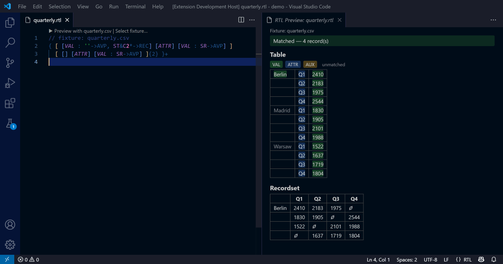
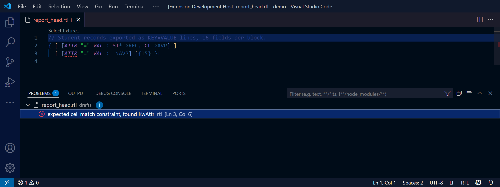
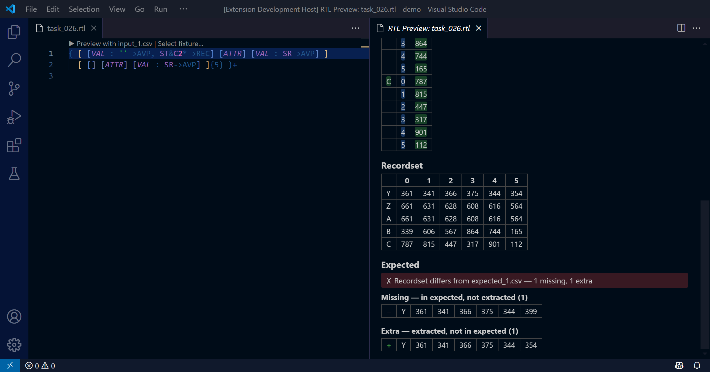
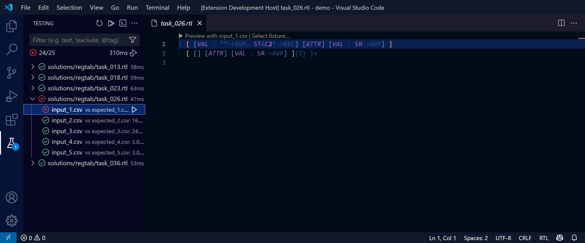
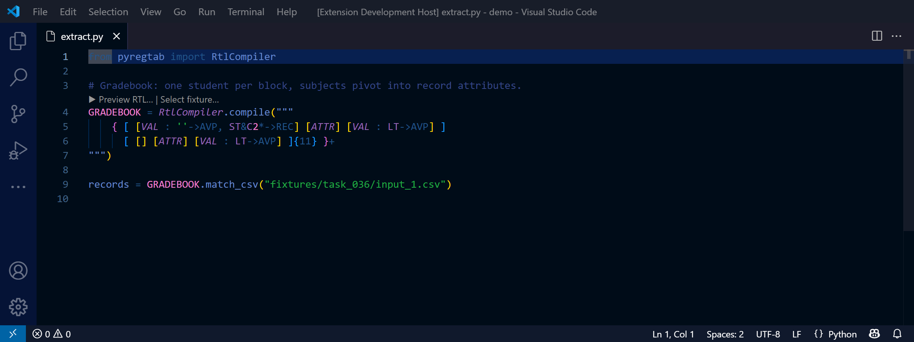

# RegTab — Regular Table Language

**RegTab matches tables the way RegEx matches text.** RTL (Regular Table Language)
is a domain-specific language (DSL) developed by the
[RegTab](https://regtab.github.io/) project for describing table patterns and
extracting structured records from tables with arbitrary layouts.

RTL patterns describe the layout of a table (subtables, rows, cells), constrain
cell content, and specify how matched cells are converted into a recordset.
This extension supports **any** RegTab implementation, including jRegTab (Java)
and pyRegTab (Python), as well as standalone `.rtl` files that are not tied to a
host runtime.

```rtl
// Airline on-time performance: header row + repeated data rows
[ [] [VAL: 'AIRLINE'->AVP]+ ]
[ [VAL: 'AIRPORT'->AVP] [VAL: (COL,ROW,CL)->REC, 'ND'->AVP ' ' VAL: 'MON'->AVP]+ ]+
```



## Installation

Open the Extensions view (`Ctrl+Shift+X`), search for **Regular Table
Language**, and click Install — or run:

```
ext install regtab.regtab
```

Syntax highlighting and snippets work out of the box. Compiler diagnostics and
the live match preview are powered by `rtl-lsp`, a native language server.
Platform-specific builds include the server. On other platforms, set
`rtl.server.path` to your own `rtl-lsp` binary — see the
[FAQ](https://github.com/regtab/vscode-rtl/blob/main/docs/faq.md).

## Features

- **Compiler diagnostics as you type** — powered by `rtl-lsp`, a standalone
  native language server built on the RegTab Rust core. Errors are underlined
  at their exact source positions with the compiler's message — in `.rtl` files
  **and inside RTL string literals in Python and Java** (escape sequences and
  text-block indentation are mapped back to the host source correctly).
  `EXT('…')` predicates are not reported as unbound while editing standalone
  files because they bind to the host runtime only at run time.
  Platform-specific builds include the server; on other platforms, set
  `rtl.server.path` to your own binary, or use the extension with highlighting
  only.

  

- **Live match preview** — run the pattern against a CSV fixture. Each segment
  of a cell-derived item is colored by role (VAL / ATTR / AUX) within the cell
  text, the extracted recordset is shown alongside the table, and the preview
  reruns as you edit. Fixtures can be bound through a `// fixture:` directive
  (paths resolve against the file's directory; `${workspaceFolder}` is
  substituted), the *RTL: Select Fixture…* command, or the
  `rtl.fixtures.input` glob template for entire directories of patterns
  (with snippet-style `${basename/regex/replacement/}` transforms for host
  files whose names do not directly correspond to the fixture layout). The
  preview works with `.rtl` files **and RTL string literals in Python and
  Java** (`RtlCompiler.compile`, `@RtlSource`, `language=RTL` markers) through
  a CodeLens on each literal.
- **Expected-result diff** — bind an expected CSV to a fixture with an
  `// expected:` directive or the `rtl.fixtures.expected` template to compare
  the extracted recordset with the expected rows. The preview lists missing
  and extra records; rows are compared as an unordered multiset by default,
  while header handling and row ordering are configurable.

  

- **Test Explorer** — every standalone `.rtl` pattern × fixture pair with an
  expected result appears in VS Code's Testing view. Run individual pairs or an
  entire directory of patterns and view pass/fail results, with a diff for each
  failure — regression checks for pattern catalogs, with no Python or JDK
  required.

  

- **Canonical form on demand** — the *RTL: Show Canonical Form* command opens
  a read-only view of the normalized pattern, with inherited actions expanded
  at the atom level. Use it to see how the compiler interpreted the pattern or
  to compare two differently written patterns for equivalence. It is
  intentionally not a formatter: canonicalization discards comments and the
  original formatting, so your source is never modified.
- **Hover reference** for every RTL keyword — constraint semantics, action
  effects, and extractor behavior — generated from the normative RTL reference.
- **Context-aware completion** — actions after `->`, extractors after `=`,
  declared `$fragments`, known `#'tags'`, and settings inside `<…>`.
- **`$fragment` navigation** — Go to Definition, Find All References, Rename,
  and an Outline view of fragments, subtables, and rows.
- **Syntax highlighting for `.rtl` files** — keywords, actions, providers,
  extractors, fragments (`$NAME`), tags (`#'…'`), strings, comments, and
  quantifiers.
- **RTL inside Python strings** — literals passed to `RtlCompiler.compile("…")`
  (single-line, triple-quoted, and raw strings) are highlighted as RTL.
- **RTL inside Java strings** — `RtlCompiler.compile("…")`, the `@RtlSource("…")`
  annotation, Java 15+ text blocks (`"""…"""`), and literals marked with
  `/* language=RTL */`.
- **Snippets** for frequently used combinations: `ST*->REC`, `(SC{n}, SR)->REC(n)`,
  `^COL->AVP`, `('LABEL')->AVP`, `CL->JOIN(0)`, `-AV->PREFIX(', ')`, table and
  fragment skeletons, settings, and conditional cells.
- **Editor basics** — bracket matching, auto-closing pairs for `[] {} () <>`,
  and `//` line comments.

No Python, JDK, or other runtime is required — the extension is fully
self-contained.

## Embedded RTL at a glance

Highlighting, diagnostics, and the match preview also work on RTL string
literals inside host-language code:

### Python

```python
from pyregtab import RtlCompiler

pattern = RtlCompiler.compile("""
[ [ATTR]+ ]
[ [VAL : ST*->REC]+ ]+
""")
```

### Java

```java
@RtlSource("""
    [ [ATTR]+ ]
    [ [VAL : ST*->REC]+ ]+
    """)
String pattern;

var atp = RtlCompiler.compile("[ [VAL: 'LABEL'->AVP] ]+");
```

*(TextMate limitation: the opening quote must be on the same line as
`RtlCompiler.compile(` or `@RtlSource(`.)*



## Documentation

- [Binding fixtures and expected results](https://github.com/regtab/vscode-rtl/blob/main/docs/fixtures.md) —
  the `// fixture:` and `// expected:` directives, the `rtl.fixtures.*`
  templates with name transforms, input–expected pairing, comparison
  semantics, and Test Explorer discovery of pattern × fixture pairs.
- [FAQ and behavior notes](https://github.com/regtab/vscode-rtl/blob/main/docs/faq.md) —
  why there is no formatter, permissive `EXT('…')` handling, embedded-literal
  limitations, running your own `rtl-lsp`, and troubleshooting.
- [RTL reference](https://github.com/regtab/pyregtab/blob/main/docs/rtl-reference.md) —
  the language itself: constraints, actions, providers, and extractors. The
  in-editor hover documentation is generated from this document.

## Roadmap

- Excel fixtures in the preview (cell styles that CSV cannot carry).
- Semantic highlighting refinements on top of the TextMate grammar.

## Grammar version

Highlighting mirrors the normative RTL grammar `RTL.g4` from **jRegTab 0.5.1**
(RTL tokens are case-insensitive). Any change to the normative grammar must be
accompanied by a corresponding TextMate grammar update in this repository;
CI enforces keyword coverage.

## Related projects

- [jRegTab](https://github.com/regtab/jregtab) — Java implementation of RegTab.
- [pyRegTab](https://github.com/regtab/pyregtab) — Python implementation of RegTab with a Rust core.

## License

[MIT](LICENSE)
